## 1. Propósito de la práctica
Que los estudiantes comprendan cómo preparar un conjunto de imágenes antes de utilizarlas en un modelo de Inteligencia Artificial, mediante las siguientes actividades:
1. Identificar el tamaño y formato de las imágenes.
2. Organizar imágenes en carpetas según su categoría.
3. Cambiar el tamaño de las imágenes a dimensiones uniformes.
4. Convertir imágenes a un formato común.
5. Normalizar los valores de los píxeles.
6. Evaluar que las imágenes procesadas cumplan con los criterios establecidos

## Angela Correa NC = 0037
## Problema 14: Vaca y toro
## VACA
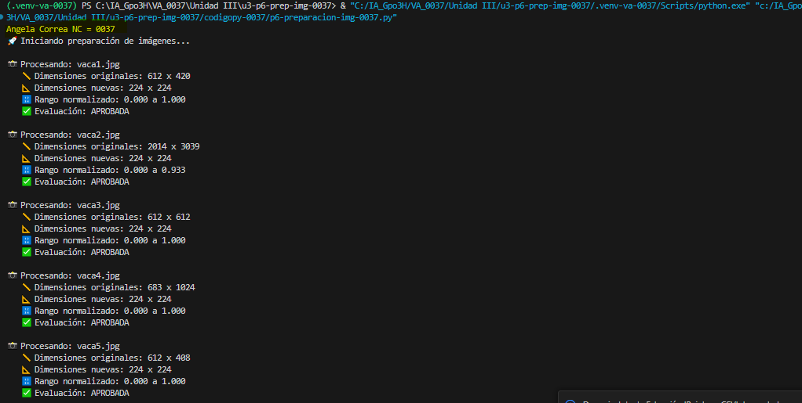
## img preparadas
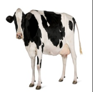
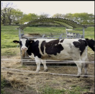
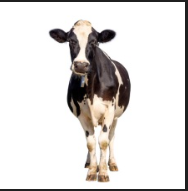
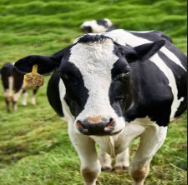
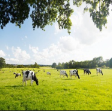
## TORO
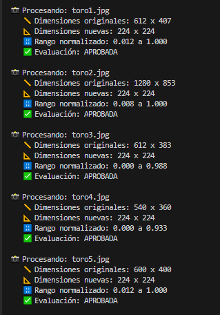
## img preparadas
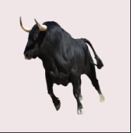
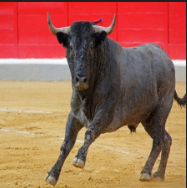
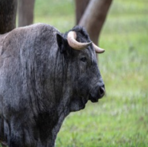
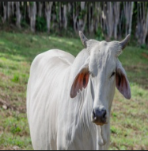
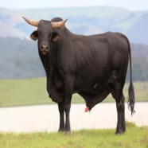
## Resumen de la practica
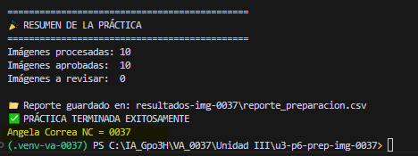
## Resultados archivo CSV
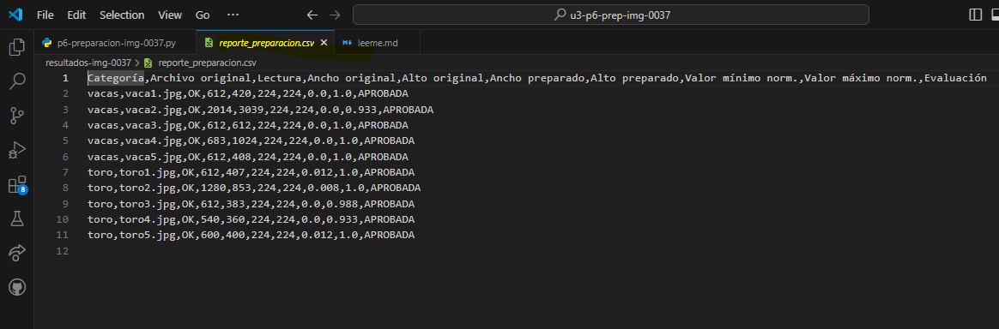